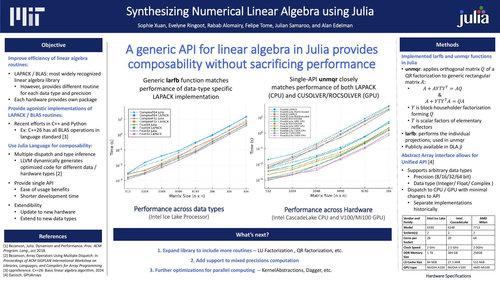

# Citing NextLA

If you use NextLA.jl in your research, please cite:

> **[1]** S. Xuan, E. Ringoot, R. Alomairy, F. Tome, J. Samaroo, and A. Edelman, "Synthesizing Numerical
> Linear Algebra using Julia," in *2024 IEEE High Performance Extreme Computing Conference (HPEC)*,
> IEEE, 2024.
>
> Available: <https://ieee-hpec.org/wp-content/uploads/2025/01/161.pdf>

```bibtex
@inproceedings{nextla1,
  title={{Synthesizing Numerical Linear Algebra using Julia}},
  author={Xuan, Sophie and Ringoot, Evelyne and Alomairy, Rabab and Tome, Felipe and Samaroo, Julian and Edelman, Alan},
  booktitle={2024 IEEE High Performance Extreme Computing Conference (HPEC)},
  year={2024},
  publisher={IEEE},
  url={https://ieee-hpec.org/wp-content/uploads/2025/01/161.pdf}
}
```

Poster, IEEE HPEC 2024:

[](docs/src/assets/ieee_hpec_poster.pdf)

> **[2]** V. Carrica, M. Onyango, R. Alomairy, E. Ringoot, J. Schloss, and A. Edelman, "Toward Portable
> GPU Performance: Julia Recursive Implementation of TRMM and TRSM," in *Asynchronous Many-Task Systems
> and Applications (WAMTA)*, Springer Nature, 2025.
>
> doi: [10.1007/978-3-031-97196-9_13](https://doi.org/10.1007/978-3-031-97196-9_13)

```bibtex
@inproceedings{nextla2,
  title={{Toward Portable GPU Performance: Julia Recursive Implementation of TRMM and TRSM}},
  author={Carrica, Vicki and Onyango, Maxwell and Alomairy, Rabab and Ringoot, Evelyne and Schloss, James and Edelman, Alan},
  booktitle={Asynchronous Many-Task Systems and Applications (WAMTA)},
  year={2025},
  publisher={Springer Nature},
  doi={10.1007/978-3-031-97196-9_13}
}
```

## Related publications

Work by the NextLA authors on algorithms that NextLA implements.

> **[3]** V. Carrica, R. Alomairy, E. Ringoot, and A. Edelman, "Hierarchical Recursive Precision for
> Accelerating Symmetric Linear Solves on MXUs," in *Euro-Par 2026: Parallel Processing*, Lecture Notes in
> Computer Science, Springer Nature, 2026, pp. 451–465.
>
> doi: [10.1007/978-3-032-35248-4_31](https://doi.org/10.1007/978-3-032-35248-4_31)
>
> Also available as [arXiv:2601.08082](https://arxiv.org/abs/2601.08082)

```bibtex
@inproceedings{carrica2026hierarchical,
  title={{Hierarchical Recursive Precision for Accelerating Symmetric Linear Solves on MXUs}},
  author={Carrica, Vicki and Alomairy, Rabab and Ringoot, Evelyne and Edelman, Alan},
  booktitle={Euro-Par 2026: Parallel Processing},
  series={Lecture Notes in Computer Science},
  pages={451--465},
  year={2026},
  publisher={Springer Nature},
  doi={10.1007/978-3-032-35248-4_31}
}
```

> **[4]** E. Ringoot, R. Alomairy, V. Churavy, and A. Edelman, "Performant Unified GPU Kernels for
> Portable Singular Value Computation Across Hardware and Precision," in *Proceedings of the 54th
> International Conference on Parallel Processing (ICPP '25)*, ACM, 2025.
>
> doi: [10.1145/3754598.3754667](https://doi.org/10.1145/3754598.3754667)

```bibtex
@inproceedings{ringoot2025performant,
  title={{Performant Unified GPU Kernels for Portable Singular Value Computation Across Hardware and Precision}},
  author={Ringoot, Evelyne and Alomairy, Rabab and Churavy, Valentin and Edelman, Alan},
  booktitle={Proceedings of the 54th International Conference on Parallel Processing (ICPP '25)},
  year={2025},
  publisher={ACM},
  doi={10.1145/3754598.3754667}
}
```

> **[5]** E. Ringoot, R. Alomairy, and A. Edelman, "Accelerating Bidiagonalization of Banded Matrices
> through Memory-Aware Bulge-Chasing on GPUs," in *ISC High Performance 2026 Research Paper Proceedings
> (41st International Conference)*, IEEE, 2026, pp. 1–14.
>
> doi: [10.23919/isc.2026.11520476](https://doi.org/10.23919/isc.2026.11520476)
>
> Also available as [arXiv:2510.12705](https://arxiv.org/abs/2510.12705)

```bibtex
@inproceedings{ringoot2026accelerating,
  title={{Accelerating Bidiagonalization of Banded Matrices through Memory-Aware Bulge-Chasing on GPUs}},
  author={Ringoot, Evelyne and Alomairy, Rabab and Edelman, Alan},
  booktitle={ISC High Performance 2026 Research Paper Proceedings (41st International Conference)},
  pages={1--14},
  year={2026},
  publisher={IEEE},
  doi={10.23919/isc.2026.11520476}
}
```
