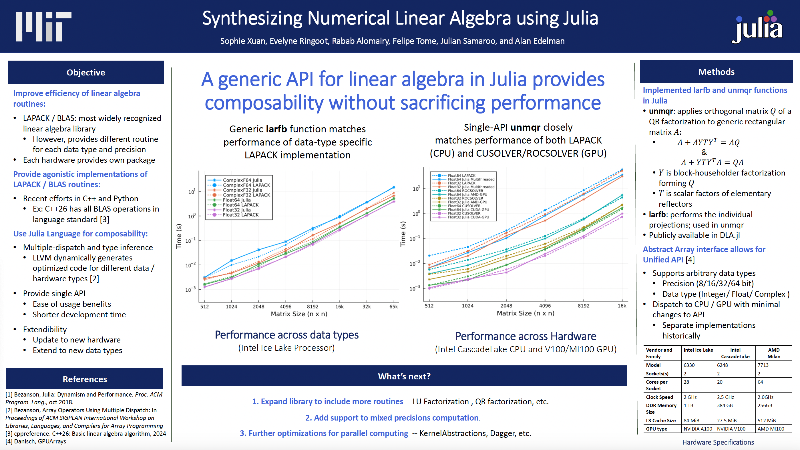

# NextLA.jl

[](https://nextlinearalgebra.github.io/NextLA.jl/dev/)
[](https://github.com/NextLinearAlgebra/NextLA.jl/actions/workflows/CI.yml?query=branch%3Amain)
[](https://codecov.io/gh/NextLinearAlgebra/NextLA.jl)

**NextLA.jl** is a hardware-agnostic, datatype-flexible **dense linear algebra** library written in pure Julia.
It reimplements LAPACK/BLAS-style routines on top of [KernelAbstractions.jl](https://github.com/JuliaGPU/KernelAbstractions.jl),
so one code path runs on **CPUs and on NVIDIA, AMD, Intel and Apple GPUs**, for `Float64`, `Float32`, `Float16`,
`BFloat16` and complex element types, and adds **mixed-precision** recursive factorizations on top.

Instead of writing one implementation per data type and per device, as Fortran and C libraries do,
NextLA relies on Julia's multiple dispatch, type inference and LLVM-based compilation to generate
specialized code for each combination.



## Features

- **Unified API.** Implements LAPACK/BLAS subroutines in Julia, avoiding type- and hardware-specific implementations.
  Supports `Float64`, `Float32`, `Float16`, complex numbers and other numerical types.
- **Multi-architecture support.** Efficiently runs on CPUs and GPUs, leveraging Julia's LLVM-based compilation: the
  same call runs on a `Matrix`, `CuArray`, `ROCArray`, `oneArray` or `MtlArray`.
- **High performance.** Benchmarks show that Julia-based implementations achieve performance on par with or exceeding
  LAPACK/CUSOLVER.
- **Mixed precision.** Recursive factorizations on matrices that store each block in its own
  precision, from `Float64` down to `Float8_E5M2`.
- **Tile low-rank.** Matrices stored as tiles compressed to low rank by adaptive randomized approximation, with GEMM
  between compressed and dense matrices.
- **Future-proof and composable.** Designed for extensibility, allowing new data types and hardware architectures to be
  integrated with minimal modifications.

## Why Julia for dense linear algebra?

Traditionally, linear algebra libraries have been optimized for Fortran and C, requiring separate implementations for
different hardware and data types. NextLA.jl leverages Julia's multiple dispatch, type inference, and metaprogramming
capabilities to dynamically generate optimized machine code, making it a future-proof alternative.

## Installation

NextLA is registered in the Julia General registry and is tested on Julia 1.10 and nightly.

```julia
using Pkg
Pkg.add("NextLA")                                              # latest release
Pkg.add(url = "https://github.com/NextLinearAlgebra/NextLA.jl") # development version
```

For GPU support, also add the backend package you want (`CUDA`, `AMDGPU`, `oneAPI` or `Metal`).

## Quick start

```julia
using NextLA, LinearAlgebra

n = 1000
A = rand(n, n)
S = A * A' + n * I                      # symmetric positive definite
B = rand(n, 5)                          # five right-hand sides

# Solve S * X = B: a Cholesky factorization, then two triangular solves
F = copy(S)
potrf_recursive!(F)                     # S = L * L', L in the lower triangle of F
X = copy(B)
trsm!('L', 'L', 'N', 'N', 1.0, F, X)    # solve L * Y = B
trsm!('L', 'L', 'T', 'N', 1.0, F, X)    # solve L' * X = Y
S * X ≈ B                               # true
```

### On a GPU

```julia
using NextLA, CUDA, LinearAlgebra

A = CUDA.rand(Float32, 1000, 1000)
S = A * A' + 1000f0 * I                 # built on the GPU
F = copy(S)
potrf_recursive!(F)                     # same call as on the CPU, runs on the GPU
tril(F) * tril(F)' ≈ S                  # true
```

For AMD, Intel or Apple GPUs, load `AMDGPU`, `oneAPI` or `Metal` and use `ROCArray`, `oneArray`
or `MtlArray` instead.

### Mixed precision

```julia
using NextLA, NextLA.MixedPrecision, LinearAlgebra

A = rand(1000, 1000)
S = A * A' + 1000I
M = SymmMixedPrec(S, 'L'; precisions = DataType[Float32, Float64])  # off-diagonal block in Float32
potrf_recursive!(M)                     # Cholesky directly on the mixed-precision matrix
L = reconstruct_matrix(TriMixedPrec(M)) # back to a dense Float64 factor
norm(L * L' - S) / norm(S)              # about 1e-8, set by the Float32 blocks
```

See the [documentation](https://nextlinearalgebra.github.io/NextLA.jl/dev/) for the full guide and API reference.

## Documentation

The documentation is built with [Documenter.jl](https://documenter.juliadocs.org/). To build it locally:

```bash
julia --project=docs -e 'using Pkg; Pkg.develop(PackageSpec(path=pwd())); Pkg.instantiate()'
julia --project=docs docs/make.jl
```

Then open `docs/build/index.html`.

## Running the tests

```bash
julia --project -e 'using Pkg; Pkg.test()'
```

This runs every test on the CPU. How to test on a GPU, run only some tests, and the other options:
[test/README.md](test/README.md).

## Citing

If you use NextLA.jl in your research, please cite the papers listed in [CITATION.md](CITATION.md)
(BibTeX included). GitHub's "Cite this repository" button uses [CITATION.cff](CITATION.cff).

## Contributors

- Rabab Alomairy ([@Rabab53](https://github.com/Rabab53))
- Sophie Xuan ([@Azura-yuwi](https://github.com/Azura-yuwi))
- Evelyne Ringoot ([@evelyne-ringoot](https://github.com/evelyne-ringoot))
- Vicki Carrica ([@vickicarrica](https://github.com/vickicarrica))
- Maxwell Onyango ([@maxmlewa](https://github.com/maxmlewa))
- Julian Samaroo ([@jpsamaroo](https://github.com/jpsamaroo))
- Felipe Tome ([@fda-tome](https://github.com/fda-tome))
- Abdulmalik Alquwayfili ([@aalquwayfili](https://github.com/aalquwayfili))
- Akhil Akkapelli ([@AkhilAkkapelli](https://github.com/AkhilAkkapelli))
- Alessandro Carraro ([@alecarraro](https://github.com/alecarraro))
- Xavier Henry ([@silentPenguin07](https://github.com/silentPenguin07))
- Joseph Zhang ([@jz268](https://github.com/jz268))
- Eric Lin ([@cire694](https://github.com/cire694))
- Ruhundaka Ejilemele ([@r-ejilemele](https://github.com/r-ejilemele))

## License

MIT, see [LICENSE](LICENSE).
